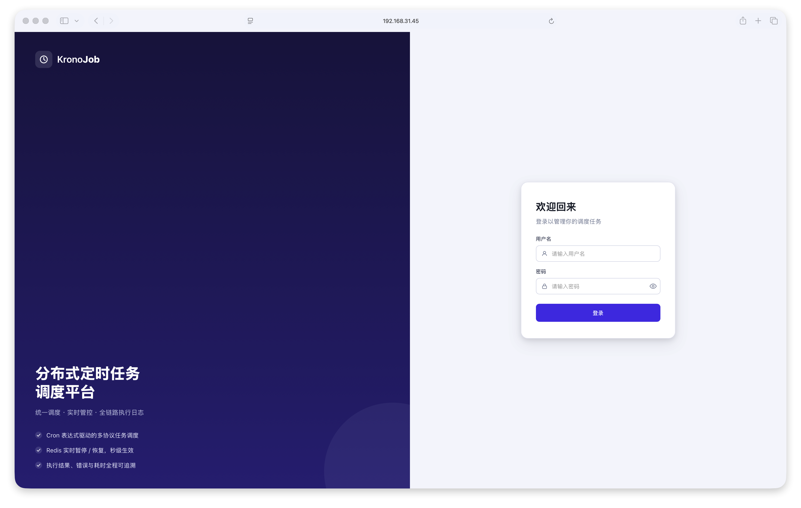
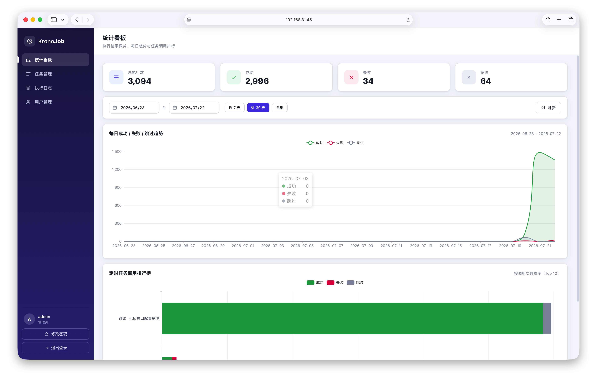
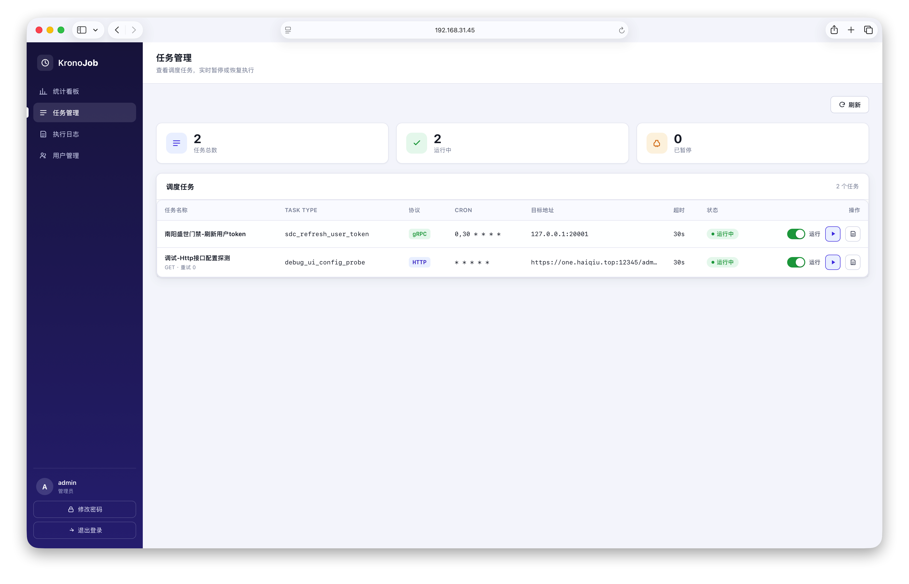
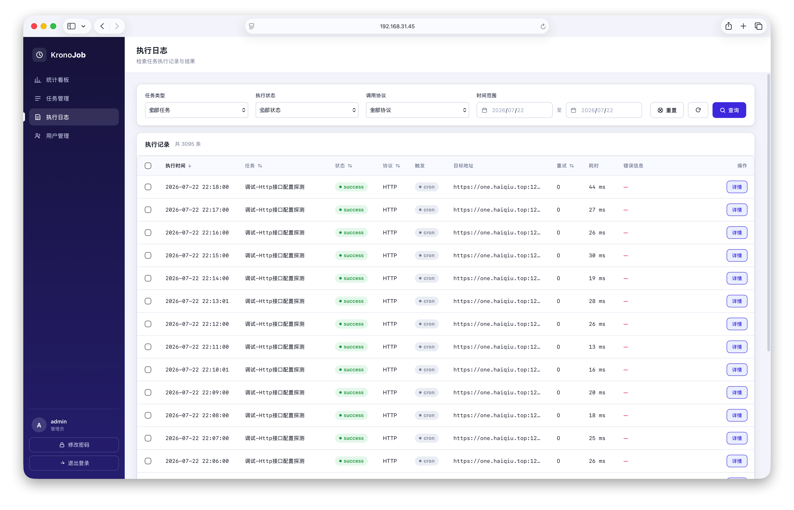
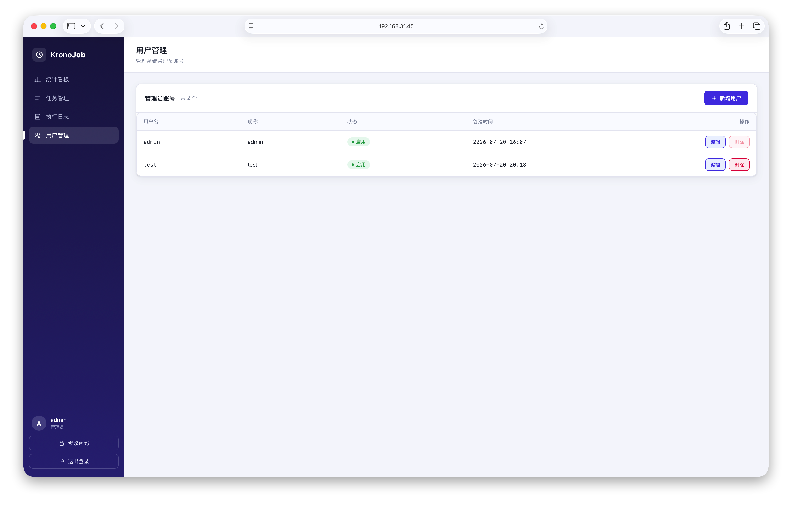

# krono-job

定时任务调度平台：Go（Gin + Asynq）后端 + Vue3 前端，内置 PostgreSQL 与 Redis 的**一体化**部署镜像。

> 单次 `docker run` 即可独立运行全部组件（Web/API + 调度内核 + 工作进程 + PostgreSQL + Redis），无需外部依赖。

---

## 0. 效果展示

管理后台基于 Vue3（经 `go:embed` 打包进二进制），默认访问 `http://localhost:10010`。

| 页面 | 截图 |
| --- | --- |
| 登录页 |  |
| 仪表盘（统计概览） |  |
| 任务管理 |  |
| 执行日志 |  |
| 用户管理 |  |

各页面的功能说明详见 [`docs/images/README.md`](docs/images/README.md)。

---

## 1. 镜像构建

构建为多阶段镜像：`node` 构建前端 → `golang` 用 vendored 依赖离线构建二进制 → `ubuntu` 内置 PostgreSQL 16 + Redis 7。

```bash
# 标准构建（需可访问 Docker Hub）
docker build -t krono-job:latest -f build/Dockerfile .

# 国内网络：使用镜像加速源（base 镜像 + apt 源均可覆盖）
docker build -t krono-job:latest \
  --build-arg BASE_REGISTRY=docker.m.daocloud.io \
  --build-arg APT_MIRROR=http://mirrors.aliyun.com/ubuntu \
  -f build/Dockerfile .
```

构建前提：

- `web/dist` 由镜像内 `node` 阶段重新构建，无需本地预构建。
- gRPC 类任务直接在 `configs/jobs.yaml` 中以 `protocol: grpc` 声明即可（见下方「gRPC 任务配置」），无需改动代码或引入额外依赖。

---

## 2. 运行（单镜像独立运行）

```bash
docker run -d --name krono-job \
  -p 10010:10010 \
  -p 5432:5432 \
  -p 6379:6379 \
  -e KRONO_JWT_SECRET=请改成随机长字符串 \
  krono-job:latest
```

- 平台 Web / API：`http://localhost:10010`
- PostgreSQL：`localhost:5432`（用户 `krono` / 密码 `kronopass`，库 `krono_job`）
- Redis：`localhost:6379`（无密码）

---

## 3. 运行（docker-compose，附带 asynqmon 监控）

```bash
docker compose -f build/docker-compose.yml up -d
```

- 平台：`http://localhost:10010`
- asynqmon 队列监控：`http://localhost:8080`（连接 `krono:6379`）

---

## 4. 配置（环境变量）

所有配置均可通过环境变量（或 `.env` 文件）注入，环境变量优先级高于 `configs/config.yaml` 中的默认值。

**使用 `.env` 文件（推荐，避免敏感信息入库）**：

1. 复制模板：`cp .env.example .env`
2. 编辑 `.env` 填入真实值（数据库密码、JWT 密钥、管理员密码等敏感项仅存在于 `.env`，
   `.env` 已被 `.gitignore` 忽略，不会提交到仓库）。
3. 程序已引入 `github.com/joho/godotenv/autoload`，启动时自动加载运行目录下的 `.env`；
   容器部署也可通过 `docker run --env-file .env` 或 docker-compose 的 `env_file` 注入。

变量命名规则：`KRONO_<SECTION>_<KEY>`（与 `configs/config.yaml` 层级对应，`.` 换成 `_`），
完整列表与说明见仓库根目录 `.env.example`。`configs/config.yaml` 现仅保留非敏感默认值，
敏感项（密码 / 密钥 / 初始管理员密码）一律由环境变量提供。

以下为镜像内置默认值（均可被环境变量覆盖）：

| 变量 | 默认 | 说明 |
| --- | --- | --- |
| `KRONO_SERVER_PORT` | `10010` | HTTP 监听端口 |
| `KRONO_REDIS_ADDR` | `127.0.0.1:6379` | Redis 地址（容器内） |
| `KRONO_REDIS_PASSWORD` | 空 | Redis 密码 |
| `KRONO_POSTGRES_HOST` | `127.0.0.1` | PostgreSQL 主机（容器内） |
| `KRONO_POSTGRES_PORT` | `5432` | PostgreSQL 端口 |
| `KRONO_POSTGRES_USER` | `krono` | 数据库角色 |
| `KRONO_POSTGRES_PASSWORD` | `kronopass` | 数据库密码 |
| `KRONO_POSTGRES_DBNAME` | `krono_job` | 数据库名 |
| `KRONO_POSTGRES_SCHEMA` | `public` | 模式 |
| `KRONO_POSTGRES_SSLMODE` | `disable` | SSL 模式 |
| `KRONO_BOOTSTRAP_ADMIN_USER` | `admin` | 首个管理员用户名（表空时插入） |
| `KRONO_BOOTSTRAP_ADMIN_PASS` | `admin123` | 首个管理员密码（**生产务必修改**） |
| `KRONO_JWT_SECRET` | `change-me-in-prod` | JWT 签名密钥（**生产务必修改**） |

PostgreSQL 的**角色 / 数据库 / `uuid-ossp` 扩展**由 `build/entrypoint.sh` 在容器启动时幂等创建，
平台二进制启动时自动执行表迁移与管理员 bootstrap，无需手动初始化。

调度任务在 `configs/jobs.yaml` 中声明，支持 fsnotify 热重载（修改文件无需重启）。

### gRPC 任务配置

gRPC 任务纯声明式，无需编写对接代码。在 `configs/jobs.yaml` 的 `jobs` 列表中新增一项，
指定下游 `endpoint`（host:port）、服务方法、请求类型与载荷即可：

```yaml
jobs:
  - name: 示例-gRPC调用
    task_type: example_grpc_call        # 全局唯一，用于日志与暂停态标记
    cron: "0,30 * * * *"                # 标准 5 字段 cron：分 时 日 月 周
    protocol: grpc                      # 声明为 gRPC 协议
    enabled: true
    timeout: 30s                        # 单次调用超时，超时按失败处理
    retry: 2                            # Asynq 最大重试次数
    endpoint: "svc-host:9000"           # 下游 gRPC 服务 host:port
    grpc_service: "pkg.Service"         # 包.服务，如 sdc.Invoke
    grpc_method: "MethodName"           # 方法名，最终调用 /pkg.Service/MethodName
    request_type: "pkg.ReqTypeName"     # 请求消息全类型名，用于反序列化 payload
    payload:                            # 方法入参，按 request_type 序列化后发出
      field_a: "value"
      field_b: 123
    metadata:                           # 可选：gRPC metadata（如鉴权头）
      authorization: "Bearer ${SVC_TOKEN}"
```

字段说明：

- `protocol: grpc`：触发 gRPC 适配分支；`endpoint` 为目标服务地址，`grpc_service`/`grpc_method` 拼出方法全路径。
- `request_type`：调度内核据此将 `payload` 反序列化为对应 proto 请求类型，无需在代码中 import 具体 pb。
- `metadata`：可选 gRPC metadata；值支持 `${ENV}` 引用环境变量（启动时替换）。
- 其余 `cron` / `timeout` / `retry` 与 HTTP 任务语义一致。

---

## 5. 数据持久化

镜像内 PostgreSQL 数据目录为 `/var/lib/postgresql/data`。如需跨容器重建保留数据，挂载卷：

```bash
docker run -d --name krono-job \
  -p 10010:10010 -p 5432:5432 -p 6379:6379 \
  -v krono-pgdata:/var/lib/postgresql/data \
  krono-job:latest
```

---

## 6. 说明与排查

- 健康检查：`GET /healthz` 返回 `{"status":"ok"}`。
- 启动日志可见 Redis / PostgreSQL 初始化、角色库扩展创建、Scheduler/Worker 启动。
- 已修复：`sdc_refresh_user_token` 任务的 cron 表达式原采用 Quartz 风格（`0 0,30 * * * ?`），在 asynq 标准 5 字段
  cron 下被误解析为「小时 30」而报错；已改为标准写法 `0,30 * * * *`（每 30 分钟触发一次）。
- 构建若提示 `exec format error`：确保 `build/entrypoint.sh` 为 Unix 换行（LF，无 BOM）。

---

## 7. 本地运行（不使用 Docker）

适用：希望在本机直接用 `go run` 运行，依赖本机已安装的 PostgreSQL 与 Redis（不打包进镜像）。

### 7.1 前置依赖

| 依赖 | 版本要求 | 说明 |
| --- | --- | --- |
| Go | 1.26.5+ | 与 `go.mod` 一致 |
| Node.js | ≥ 22.18.0 或 ≥ 24.12.0 | 仅用于构建前端 |
| pnpm | 随 Node corepack 启用 | `corepack enable` |
| PostgreSQL | 16+ | 需本机运行，并创建角色 / 库 / 扩展 |
| Redis | 7+ | 需本机运行 |

Windows 可用包管理器安装：`scoop install postgresql redis` 或 `choco install postgresql redis-64`。

### 7.2 准备 PostgreSQL 与 Redis

1. 启动本机 PostgreSQL、Redis 服务。
2. 以 superuser（`postgres`）执行 `build/init-db.sql`，幂等创建 `krono` 角色、`krono_job` 库并预置 `uuid-ossp` 扩展：

   ```bash
   psql -U postgres -f build/init-db.sql
   ```

   > 为何手动跑？`uuid-ossp` 扩展需 superuser 权限创建；平台启动时的自动迁移以 `krono` 角色执行 `CREATE EXTENSION IF NOT EXISTS`，若扩展已存在则为无操作。跳过此步会导致迁移失败。

3. 确认 Redis 监听 `127.0.0.1:6379`，无密码（默认）。

### 7.3 配置敏感项

```bash
cp .env.example .env
# 编辑 .env 填入：KRONO_JWT_SECRET、KRONO_BOOTSTRAP_ADMIN_PASS、KRONO_POSTGRES_PASSWORD 等
```

本地默认值说明（`configs/config.yaml`，与镜像默认值不同）：

- PostgreSQL：角色 `krono` / 密码 `password`（注意：镜像内为 `kronopass`），库 `krono_job`；
- Redis：`127.0.0.1:6379`，DB `15`（注意：镜像内为 DB `0`）；
- 若直接使用默认 `config.yaml`，请确保 7.2 中创建的 `krono` 角色密码为 `password`；否则用 `.env` 的 `KRONO_POSTGRES_PASSWORD` 覆盖。

### 7.4 构建前端（须先于后端编译）

前端产物 `web/dist` 通过 `go:embed` 打包进后端二进制，因此**必须先在 `web/` 构建前端**：

```bash
cd web
pnpm install
pnpm build          # 等价于 build-only（跳过 vue-tsc 类型检查）
# 如需严格类型检查：pnpm build
```

产物生成于 `web/dist`；仓库已附带一份 `web/dist`，若仅修改后端可直接跳过本步。

### 7.5 运行（`go run`）

```bash
# 从仓库根目录执行，默认加载 configs/config.yaml
go run ./cmd/server

# 或显式指定配置文件
go run ./cmd/server -f configs/config.yaml
```

启动后平台会：自动迁移建表 → 创建首个管理员（账号 `admin` / 密码取自 `.env` 的 `KRONO_BOOTSTRAP_ADMIN_PASS`）→ 启动 Asynq Scheduler 与 Worker。

- 平台 Web / API：`http://localhost:10010`
- 健康检查：`GET /healthz` → `{"status":"ok"}`

可选：单独执行数据库迁移（建表 / 扩表）：

```bash
go run ./cmd/migrate
```

---

## 8. 本地编译二进制

### 8.1 编译

确保前端已构建（`web/dist` 就绪）后，使用已落地的 `vendor/` 离线依赖编译：

```bash
go build -mod=vendor -ldflags="-s -w" -o bin/krono-job ./cmd/server
```

- `-mod=vendor`：使用 `vendor/`（含 `gitee.com` 私有依赖），无需访问网络或 Git 凭证；
- `-ldflags="-s -w"`：去除调试信息，减小体积；
- 二进制已内置前端（`web/dist`）与自动迁移、管理员 bootstrap，单文件即可运行。

### 8.2 运行二进制

```bash
# configs/（含 config.yaml、jobs.yaml）需与运行目录相对路径一致
./bin/krono-job -f configs/config.yaml
```

> 二进制默认读取**当前工作目录**下的 `configs/config.yaml` 与 `configs/jobs.yaml`。若把二进制放到别处，请一并复制 `configs/` 目录，或用 `-f` 指定绝对路径。

### 8.3 跨平台交叉编译

本项目无 CGO 依赖，可直接交叉编译：

```bash
# Linux amd64
CGO_ENABLED=0 GOOS=linux GOARCH=amd64 \
  go build -mod=vendor -ldflags="-s -w" -o bin/krono-job-linux-amd64 ./cmd/server

# macOS arm64
CGO_ENABLED=0 GOOS=darwin GOARCH=arm64 \
  go build -mod=vendor -ldflags="-s -w" -o bin/krono-job-darwin-arm64 ./cmd/server

# Windows amd64（PowerShell）
$env:CGO_ENABLED=0
go build -mod=vendor -ldflags="-s -w" -o bin/krono-job.exe ./cmd/server
```

### 8.4 常见问题

- 前端页面空白 / 提示「前端未构建」：未先构建 `web/dist`，请回到 7.4 构建前端后再编译后端。
- 迁移报 `permission denied to create extension "uuid-ossp"`：未以 superuser 执行 `build/init-db.sql`，见 7.2。
- 连接 PG / Redis 失败：确认本机服务已启动，且地址 / 密码与 `.env` 或 `config.yaml` 一致（本地默认见 7.3）。
- 找不到 `configs/jobs.yaml`：在运行目录下确认 `configs/` 存在，或用 `-f` 指定配置路径（`KRONO_JOBS_PATH` 也可经环境变量覆盖）。

---

## 9. 分布式部署（多节点调度 + 下游负载均衡）

v2 起支持真正的分布式运行：多个 `krono-job` 实例共享同一 Redis 与 PostgreSQL，
既避免「多实例重复触发任务」，又能向**多个下游被调用方节点**分发并做负载均衡与故障剔除。

### 9.1 三大能力

| 能力 | 实现 | 说明 |
| --- | --- | --- |
| 调度高可用（去重） | Redis 选主（Leader Election） | 多实例竞争同一把 Redis 锁，仅 **Leader** 运行 Asynq Scheduler 触发 `krono:dispatch`；其余实例作为纯 Worker 消费。Leader 宕机后锁过期，其它节点自动接任（failover）。 |
| 下游存活判定（探活） | 调用方主动探测（Probe） | **下游节点不注册、不写 Redis**（避免臃肿服务适配注册协议）。存活完全由 krono-job 主动探测决定：分发前对候选 endpoint 做轻量探测（gRPC=标准 Health 协议回退 TCP 连通；HTTP=HEAD /healthz，**连接失败/超时/5xx 一律判不健康，不会因 TCP 端口通就误判存活**），失败即剔除；探测结果写入 Redis 集中共享（前端看板与各实例统一读取），本地内存缓存加速分发决策。 |
| 负载均衡 | `internal/loadbalance` | 从「配置且存活」的节点中按策略选目标：`round_robin`（默认）/ `least_conn` / `random` / `consistent`（一致哈希，同 `task_type` 稳定命中同节点）。 |

### 9.2 启用方式

在 `configs/config.yaml` 开启 `cluster.enabled: true`（或环境变量 `KRONO_CLUSTER_ENABLED=true`），
并部署 ≥2 个 `krono-job` 实例（指向同一 Redis/PG）。每个任务在 `jobs.yaml` 用 `endpoints`（数组）代替单个 `endpoint`：

```yaml
- name: 分布式-门禁token刷新
  task_type: sdc_refresh_user_token_dist
  cron: "0,30 * * * *"
  protocol: grpc
  endpoints:                      # 多节点；优先级高于 endpoint
    - "192.168.31.45:20001"
    - "192.168.31.46:20001"
    - "192.168.31.47:20001"
  lb_strategy: "round_robin"      # round_robin | least_conn | random | consistent
  grpc_service: "sdc.Invoke"
  grpc_method: "RefreshUserToken"
  request_type: "sdc.RefreshUserTokenReq"
  payload: { uid: "", refresh_token: "" }
```

- 仅配一个 `endpoint` / `endpoints` 单元素时，自动退化为单节点直连；`cluster.enabled=false` 时整体退化为旧版单节点行为（完全向后兼容）。
- 下游服务零侵入：无需注册心跳、无需改造，krono-job 自行探测其存活并按策略分发。

### 9.2.1 gRPC 下游的探测（不只是 HTTP）

探测**同时支持 HTTP 与 gRPC**，且 gRPC 走的是真正的 RPC 级探测，而非仅端口连通：

1. **标准 gRPC Health Protocol**：调用 `grpc.health.v1.Health/Check`，返回 `SERVING` 即存活。
   这是业界标准，下游只需挂上官方健康服务即可，**业务零改动**：
   ```go
   import "google.golang.org/grpc/health"
   import "google.golang.org/grpc/health/grpc_health_v1"

   healthServer := health.NewServer()
   healthServer.SetServingStatus("", grpc_health_v1.HealthCheckResponse_SERVING)
   grpc_health_v1.RegisterHealthServer(grpcServer, healthServer)
   ```
2. **兼容回退**：若下游未实现 health 服务（返回 `Unimplemented`），自动退回 **TCP 连通判定**（端口可达即视为存活），保证旧 gRPC 服务仍可被探活。
3. 业务 RPC 接口本身无需探活——标准 health 已能反映进程是否处理了 RPC；若要更严格（验证某业务 method 真的可用），可在下游自行把该 method 的就绪状态写入 health 的 `ServingStatus`。

> 探测使用与下游调用一致的 insecure 明文连接；如需 mTLS，在 `internal/cluster/grpc_health.go` 的 `grpc.NewClient` 处扩展 `credentials` 即可（与 `pkg/grpcpool` 同步）。

### 9.2.2 内网 HTTPS 下游跳过证书校验

下游若是内网自签证书、或证书绑定的 IP 与实际访问 IP 不一致（例如证书签发给 `192.168.31.1` 但实际访问 `192.168.31.45`），Go 默认会拒绝 TLS 连接，报错类似：

```
http do: Get "https://192.168.31.45:16677/...": tls: failed to verify certificate:
x509: certificate is valid for 192.168.1.1, 192.168.31.1, ... not 192.168.31.45
```

此时开启跳过证书校验即可「直接访问、不拒绝」：

```yaml
cluster:
  skip_verify_tls: true    # KRONO_CLUSTER_SKIP_VERIFY_TLS（默认 false，保持安全校验）
```

- 该开关**同时作用于分发调用（`pkg/httputil`）与存活探测（`cluster` 的 HTTP 探活）**，保证两端语义一致：要么都跳过、要么都校验。
- `false`（默认）时保持标准安全校验，证书不信任会调用失败并记入 `job_exec_log`（符合生产安全要求）。
- 仅影响 **HTTPS** 下游；普通 HTTP 不受影响。
- 如确需兼顾安全，建议下游改用与访问地址匹配的证书或公网可信 CA，而非长期跳过校验。

### 9.3 运维观测

- `GET /api/cluster/status`：返回本节点角色（`leader` / `follower` / `standalone`）。
- `GET /api/cluster/nodes`：返回调用方探测得到的下游节点健康视图（endpoint / alive / error / checked），仅 `enabled=true` 有数据。
- 调度日志会打印每个 dispatch 命中的 `endpoint`、`endpoints`、`distributed` 与选主状态，便于排查。

### 9.4 关键源码位置

- `internal/cluster/leader.go`：Redis 选主（Lua 保证续租原子性）。
- `internal/cluster/probe.go` + `registry.go`（`NodeHealth`）：调用方主动探测与探测结果内存缓存（下游不写 Redis）。
- `internal/loadbalance/loadbalance.go`：负载均衡策略。
- `internal/worker/worker.go` 的 `selectEndpoint`：分发前「探测过滤 + 负载均衡」选目标。
- `internal/scheduler/jobdef.go`：`JobDef.Endpoints` / `LBStrategy` 配置与解析。
